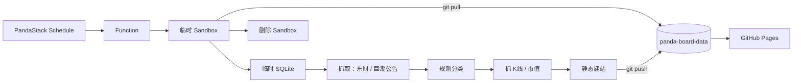

# A股公告看板 · Panda Board

https://img.shields.io/badge/Python-3.10%2B-3776ab?style=flat-square&logo=python&logoColor=white https://img.shields.io/badge/SQLite-3.25%2B-003b57?style=flat-square&logo=sqlite&logoColor=white https://img.shields.io/badge/PandaStack-Sandbox-ff6b35?style=flat-square https://img.shields.io/badge/GitHub%20Pages-live-2ea44f?style=flat-square&logo=githubpages&logoColor=white

**A股公告看板：定时抓取东财 / 巨潮公告、K线、市值，规则分类后生成静态看板，由 GitHub Pages 对外发布。**

采集跑在 PandaStack 的一次性沙箱里，数据与站点长期存在 GitHub，不需要常驻服务器、不需要数据库托管。

> 配套仓库：[panda-board-data](https://github.com/baibiaowang/panda-board-data)（数据仓 + 发布源）· [panda-board-full](https://github.com/baibiaowang/panda-board-full)（备用全量回补）

---

## 它解决什么问题

想每天盘中/盘后看全市场公告，通常有两条路：买数据终端，或者自己搭一套常驻爬虫 + 数据库 + 网站。后者的问题是运维成本——服务器要钱、SQLite 要备份、爬虫挂了没人知道。

这个项目把这套链路拆成两半：

| 部分 | 放在哪 | 为什么 |
|---|---|---|
| 抓取与建站 | PandaStack 一次性沙箱，跑完即删 | 计算是临时的，不需要常驻资源 |
| 数据与站点 | GitHub（数据仓 + Pages） | 免费、有版本历史、天然备份 |
| 调度 | PandaStack Schedule | 不需要自己的 cron 服务器 |

**关键约束：采集不完整、建站失败或 Git push 未确认时，不提交新版本。** 网站继续使用上一版数据，而不是上线一份残缺的数据。

## 架构



## 快速开始（本地，不碰线上）

需要 Python 3.10+（实测 3.12）、SQLite 3.25+；前端测试需要 Node.js 18+。

```bash
python3 -m venv .venv
.venv/bin/python -m pip install -r requirements.txt

# 跑测试
.venv/bin/python -m unittest discover -s tests -v
.venv/bin/python tools/test_http_pool.py
node tests/test_frontend.cjs
```

Windows 上解释器换成 `.venv\\Scripts\\python.exe`。核心采集与建站可在 Windows 本地跑；固定 worker 的部署脚本需要 PandaStack 的 Linux 环境。

### 60 秒看一眼效果（离线模拟数据）

```bash
export BOARD_FETCHER=mock
export BOARD_DATA_DIR="$PWD/data-demo"
export BOARD_SITE_DIR="$PWD/dist-demo"
.venv/bin/python -m app.cli run --mode full --lookback-days 3 --max-attempts 1
.venv/bin/python -m app.cli build
.venv/bin/python -m http.server 8080 --directory dist-demo --bind 127.0.0.1
```

打开 `http://127.0.0.1:8080/`。页面会标注"模拟数据演示"。

> 上线前必须移除 `BOARD_FETCHER=mock`，不要把演示库当生产库。这些示例目录专供本地演示，不会自动清理或覆盖已有数据库。

## 常用命令

| 命令 | 作用 |
|---|---|
| `python -m app.cli check` | 检查配置、挂载要求、SQLite 完整性和磁盘；首次运行会执行带备份的迁移 |
| `python -m app.cli run` | 采集近期公告并补扫 90 天内历史日期，刷新当前事件股行情 |
| `python -m app.cli run --mode full --start YYYY-MM-DD --end YYYY-MM-DD` | 补抓明确日期区间（两端包含） |
| `python -m app.cli gaps --days 90` | 区分未抓取、不完整和来源确认零公告；有缺口时退出码 1 |
| `python -m app.cli build` | 从一致的数据库快照生成静态产物，附哈希清单 |
| `python -m app.cli publish` | 推送独立 `data` 分支，并等待该提交对应的部署变成 live |
| `python -m app.cli cycle` | 采集 → 构建 → 推送 → 部署确认，即使新增 0 条也会尝试发布 |
| `python -m app.cli backup --to /abs/new-backup.db` | SQLite 在线备份，包含尚未 checkpoint 的 WAL 内容 |
| `python -m app.cli seed --from /abs/backup.db` | 导入已验证备份；目标库已存在时必须显式 `--force`，并自动留旧库备份 |
| `python -m app.cli reclassify` | 按当前规则重新分类已保留的公告，不重新下载全文 |

所有数据库 CLI 都加进程锁。`--no-deploy` 是明确的"仅推 Git、不确认上线"，不会被标成部署成功。任务失败退出非零；`cycle` 即使发布了可用的旧数据，也不会把不完整采集改写成成功。

## 数据口径（重要）

这个项目**不做投资判断**，只做公告聚合与展示。几条边界写在代码里，也写在这里：

- 公告只取标题、日期、关联股票、原文链接等**元数据**；**不下载、不解析公告 PDF 全文**。分类是可配置的关键词规则，不是对公告法律含义、利好利空或投资价值的认定。
- 近 90 天按北京时间的自然日计算，含周末和节假日。完整性只表示选定来源的分页与源计数校验通过，**不代表交易所公告全覆盖**。
- 展示档位（近 3/7/15/30 个交易日）按「最近 N 个有公告的日期」回溯，而非自然日；周末与长假期间窗口自动前移，不会出现"近 3 天全空"的假空窗。前端 `dataDates()` 与构建侧 `home.json` 同口径。
- 默认东财公告；巨潮为可选源，默认查询沪深两栏，**不能宣称覆盖北交所**。切换源后按新来源单独记账，历史数据不自动删除。
- K线默认请求最近 160 根已收盘日线，网页提供最多 120 根，默认可视最近 60 根。同一价格段保持同一来源、复权口径与快照版本，缺失不填 0。有前复权就按前复权显示，只有不复权数据时明确标注。
- `日` / `5日` 是最近 1 / 5 个价格间隔的累计变化，不代表北京时间今天一定有新行情。
- `窗口首公告` 是窗口中该股首条公告日前一根收盘价至最新收盘价的变化，不随界面筛选重算，**不是公告发布后可实际买入的收益**。无基准价显示 `—`。
- 参考市值首次成功获取后缓存，不按天刷新，不冒充实时市值。
- 无响应、超时、格式错误都**不等于**"零公告/无行情"；旧数据保留并标记为不完整。

## 项目结构

| 目录 | 用途 |
|---|---|
| `app/` | 采集、分类、SQLite、构建、发布、命令行 |
| `app/sources/` | 东财/巨潮公告、腾讯/东财日线、离线模拟数据 |
| `config/` | 分类规则与不含真实密钥的配置样例 |
| `function/` | 无密钥源码包、定时任务启动器与部署工具 |
| `scripts/` | 固定 worker 的初始化和任务入口 |
| `tools/` | 固定 worker 控制、诊断、备份和源探测 |
| `web/` | 网页模板、交互脚本、ECharts 定制包 |
| `tests/` | 自动化业务 / 运维 / 前端行为测试 |
| `docs/` | 部署说明 [GITHUB_PANDA_DEPLOY.md](docs/GITHUB_PANDA_DEPLOY.md) · 规划 [PLAN.md](docs/PLAN.md) |

## 状态与边界

线上运行中。数据仓与站点：[panda-board-data](https://github.com/baibiaowang/panda-board-data)。

诚实说明：本项目在**没有有效 PandaStack / GitHub 凭据、没有线上 `board.db`、真实源连接超时**的条件下完成了修复与测试。交付的是可运行、带测试的源码与部署说明，**不是一次已完成验收的线上替换**。部署步骤和已知未验证项见 docs 目录。

## License

未指定。公开仓库如需复用请先开 issue 沟通。
